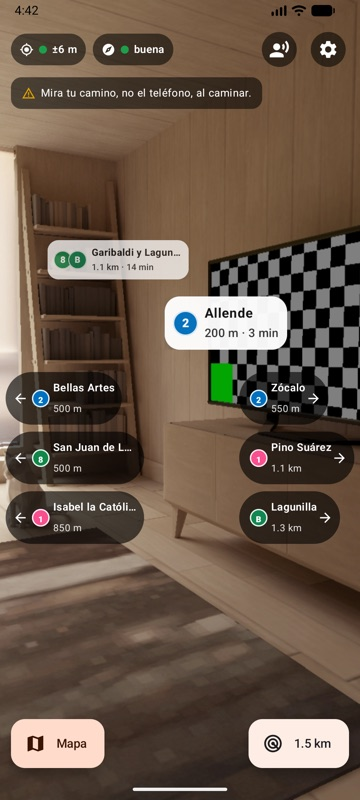
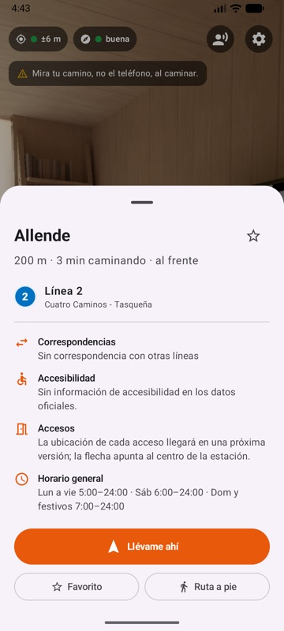
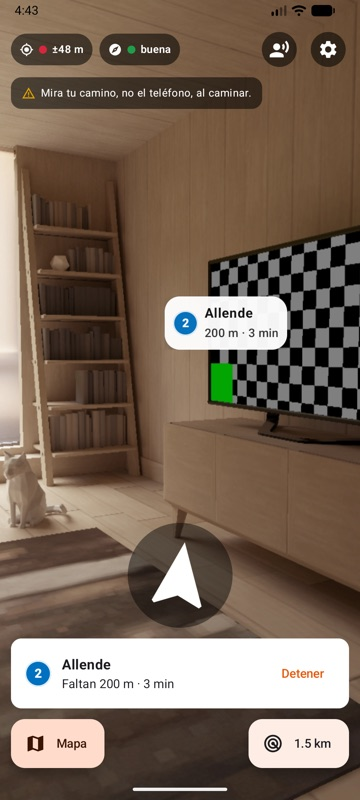
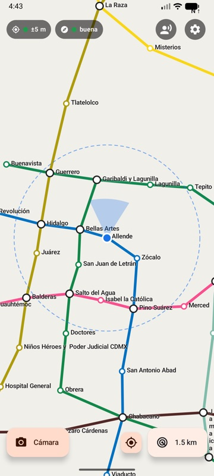
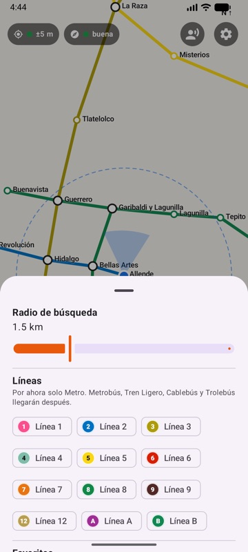
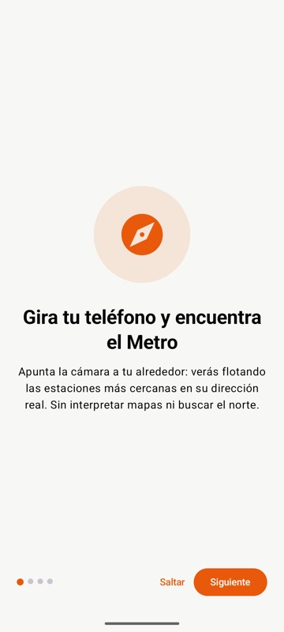
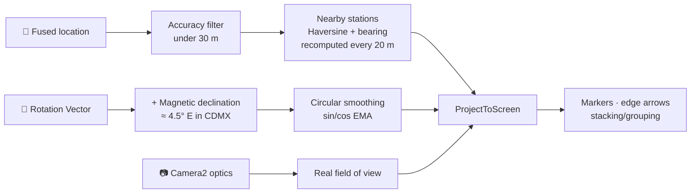
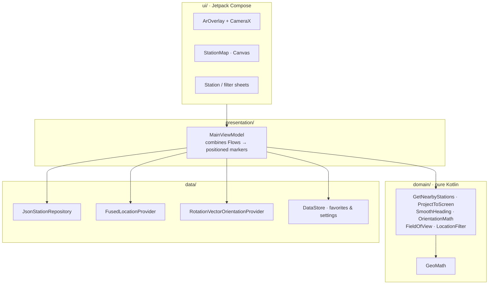

<div align="center">


# MetroAR CDMX

**Point your phone around you and see which way to walk to the nearest Mexico City Metro, Metrobús, or train station.**

Augmented reality markers float in the real direction of each station, with its official line color and number, distance, and walking time. It also works offline.

[](https://github.com/AaronUgalde/MetroAR-CDMX/actions/workflows/android.yml)


-3DDC84?logo=android&logoColor=white)


[Features](#features) · [Screenshots](#screenshots) · [How it works](#how-it-works) · [Getting started](#getting-started) · [Architecture](#architecture) · [Roadmap](#roadmap)

</div>

---

## Why

When you walk out of a museum or a meeting in a part of the city you don't know, a 2D map makes you work out which way north is first. MetroAR skips that step: turn the phone and the station is right there in front of you.

| Who | What they need | Example |
|---|---|---|
| 🧳 Tourists | Get oriented without reading a map or asking anyone | Leaving a museum downtown and looking for the closest station |
| 🏘️ Residents in a new area | Find alternatives to their usual route | A meeting in an unfamiliar neighborhood |
| 🎒 Students and workers | Save time between activities | "Should I take Line 3 or Line 7?" |
| ♿ People with reduced mobility | Know which stations are accessible | Show only accessible stations |

## Screenshots

<table>
  <tr>
    <td align="center"><br/><sub><b>AR view</b></sub></td>
    <td align="center"><br/><sub><b>Station sheet</b></sub></td>
    <td align="center"><br/><sub><b>Walking navigation</b></sub></td>
  </tr>
  <tr>
    <td align="center"><br/><sub><b>Offline map</b></sub></td>
    <td align="center"><br/><sub><b>Filters</b></sub></td>
    <td align="center"><br/><sub><b>Onboarding</b></sub></td>
  </tr>
</table>

<sub>Captured on the Android emulator with a simulated location next to Allende station (Line 2), in the historic center.</sub>

## Features

**Augmented reality**
- 📍 Markers placed in the **real direction** of every station within a configurable radius (1.5 km by default).
- 🎨 Official line **color plus number** on every marker, so you don't need to tell colors apart.
- 📏 Distance and walking minutes (estimated at 80 m/min), with nearer stations shown larger and more opaque.
- ↔️ Arrows on the edges of the screen for stations behind you or off to the side.
- 🧹 No more than 8 markers at once. Markers that would overlap are stacked or grouped as "+N", and markers near the edge slide in so they're never cut off.

**Seven transit systems**
- 🚇 **Metro**, 🚌 **Metrobús**, 🚋 **Tren Ligero**, 🚡 **Cablebús**, 🚆 **Tren Suburbano**, 🚆 **Tren El Insurgente**, and 🚎 **Trolebús**, each of which can be turned on or off in Settings. Trolebús is off by default because its 500+ stops would crowd the camera view.
- 🔵 Metro lines use **round** badges and every other system uses **square** ones, plus a system icon, so Metro Line 1 and Metrobús Line 1 never get confused.
- 🔁 **Connections between systems**: each station sheet lists nearby stations of other systems with the walking distance (e.g. Metro Balderas → Metrobús Balderas, 150 m).

**Getting there**
- 🧭 **Take me there**: a large arrow, remaining distance, and a vibration when you arrive.
- 🗺️ **Offline 2D map** with the lines drawn in their colors (Metro on top), your position, a direction cone, and the search radius. Labels never overlap, and it needs no API keys.
- 📱 Switches to the map automatically when you lay the phone flat.
- 🚶 Opens the walking route in Google Maps if you want turn-by-turn directions.

**Comfort and accessibility**
- 🔊 Voice mode: *"Estación Allende, 200 metros al frente"*.
- ⭐ Favorites, plus filters by line and radius.
- 🟢 GPS and compass accuracy indicators (green/yellow/red, always with a text label).
- ♾️ A figure-8 calibration prompt when the compass gets unreliable.
- 🌙 Dark mode, screen reader labels, and minimum 4.5:1 contrast.
- ⚠️ A visible reminder not to walk while looking at the phone.

**Privacy first**
- 🔒 Everything is computed on the device. Your location never leaves the phone and the camera never records.
- 📴 Station data ships inside the app, so it works without a connection.

> The UI is in Spanish (es‑MX). English is planned; see the [roadmap](#roadmap).

## How it works

Each frame, a marker's position comes from comparing two headings: the bearing from you to the station, and the direction the camera is pointing.

$$
\alpha = \theta_{\text{station}} - \theta_{\text{phone}} \quad\text{(normalized to } [-180^\circ, 180^\circ)\text{)}, \qquad
x = \frac{W}{2} + \frac{\alpha}{\text{FOV}/2}\cdot\frac{W}{2}
$$



| Challenge | Cause | Solution in the code |
|---|---|---|
| Noisy compass (10°–30° error) | Buildings, cars, magnetic cases | Rotation Vector sensor, accuracy tracking, figure-8 calibration prompt |
| Jittery markers | 60 Hz sensor noise | Exponential smoothing on sine/cosine, so 359° → 0° never spins |
| GPS drift between tall buildings | Urban canyon effect | Fused location; readings worse than 30 m are ignored unless nothing better exists |
| Phone held upright or flat | Sensor axes change | Heading read straight from the camera vector (−Z) of the rotation matrix |
| Each phone has a different lens | Different focal length | Real FOV from Camera2, corrected for the preview crop |
| Stations in the same direction | Overlapping markers | Sort by distance, stack in 3 levels, then group |
| Battery | Camera + GPS + sensors | Everything pauses off-screen, and GPS rate drops when you stand still |
| No Google Play Services | GMS missing or crashed | Falls back to `LocationManager` after 8 s |

## Getting started

### Prerequisites

- [Android Studio](https://developer.android.com/studio) (includes JDK 17+ and the Android SDK; the project compiles against SDK 37).
- An Android 8.0+ phone with a compass for the full experience. The emulator works too.

### Build and run

```bash
git clone https://github.com/AaronUgalde/MetroAR-CDMX.git
cd MetroAR-CDMX
./gradlew :app:assembleDebug
```

Or open the folder in Android Studio and press **▶ Run**.

<details>
<summary><b>📱 Run on a physical phone</b></summary>

1. On the phone: **Settings → About phone → tap _Build number_ 7 times**.
2. **Settings → System → Developer options →** turn on **USB debugging** (or **Wireless debugging**).
3. Connect it with a data-capable USB cable and accept the debugging prompt, or pair over Wi‑Fi from *Android Studio → Device Manager → Pair devices using Wi‑Fi*.
4. Select the phone in Android Studio and press **▶ Run**. The app stays installed afterwards.

</details>

<details>
<summary><b>🖥️ Run on the emulator with a simulated location</b></summary>

Start the AVD with a virtual camera scene (`-camera-back virtualscene`), then inject a location:

```bash
adb shell cmd location providers add-test-provider gps
adb shell cmd location providers set-test-provider-enabled gps true
adb shell cmd location providers set-test-provider-location gps --location 19.4340,-99.1372 --accuracy 6
```

</details>

### Tests

```bash
./gradlew :app:testDebugUnitTest
```

There are 38 unit tests covering Haversine, bearing, angle normalization, screen projection, stacking and grouping, heading smoothing, rotation matrices, FOV, the GPS filter, and the ViewModel (with fake location and orientation flows via [Turbine](https://github.com/cashapp/turbine)). One known case: from the Zócalo toward Bellas Artes, the bearing must point roughly west.

## Architecture

Clean Architecture with MVVM. The domain layer is **pure Kotlin with no Android dependencies**, so all the positioning math can be tested without a camera or a phone.



<details>
<summary><b>Project structure</b></summary>

```
app/src/main/
├── assets/stations.json        # generated from the CDMX GTFS
└── java/mx/metroar/cdmx/
    ├── domain/                 # models, math, use cases, repository interfaces
    ├── data/                   # JSON, location, sensors, DataStore
    ├── presentation/           # MainViewModel
    └── ui/                     # ar/, map/, components/, theme/, screens
tools/build-stations.mjs        # GTFS → stations.json
.github/workflows/              # CI + monthly data update
```

</details>

### Tech stack

| Area | Technology |
|---|---|
| Language | Kotlin 2.4 |
| UI | Jetpack Compose · Material 3 |
| Camera | CameraX + Camera2 interop (real FOV) |
| Sensors | `SensorManager` · Rotation Vector · `GeomagneticField` |
| Location | Fused Location Provider, with a `LocationManager` fallback |
| Async | Coroutines + Flow |
| Storage | Bundled JSON (kotlinx.serialization) · DataStore |
| DI | Manual (`AppContainer`) |
| Tests | JUnit 4 · kotlinx-coroutines-test · Turbine |
| CI/CD | GitHub Actions |

> **Why no Hilt or Room?** With about 1,000 stations, a bundled JSON file (~200 KB) and a linear scan (under 1 ms, rerun only every 20 m) are faster and simpler than a database, and manual DI keeps the build free of KSP. Migrating later is mechanical.

## Data

Stations, lines, and colors come from the **static GTFS** published on the [Mexico City Open Data Portal](https://datos.cdmx.gob.mx). The script picks the routes of each station-based system, merges same-name platforms into transfer stations within each system, links nearby stations of different systems (under 350 m) as connections, and stores the station order for each line. City bus networks (RTP and concessioned routes, ~9,500 stops) are left out on purpose: they would bury the camera view in markers.

```bash
node tools/build-stations.mjs          # downloads the latest GTFS
```

**Current dataset:** 36 lines · 1,000 stations · 430 with a connection to another system.

| System | Lines | Stations |
|---|---|---|
| Metro | 12 | 163 |
| Metrobús | 7 | 261 |
| Tren Ligero | 1 | 18 |
| Cablebús | 3 | 19 |
| Tren Suburbano | 1 | 7 |
| Tren El Insurgente | 1 | 5 |
| Trolebús | 11 | 527 |

A [scheduled workflow](.github/workflows/update-stations.yml) re-runs the script on the 1st of each month and opens a pull request if anything changed.

## Roadmap

- [x] AR markers with distance, walking time, scaling, and edge arrows
- [x] Station sheet, favorites, and line/radius filters
- [x] Offline 2D map with automatic switching
- [x] Walking navigation to the station, with arrival vibration
- [x] Voice mode, dark mode, and accessibility labels
- [ ] Individual station entrances (navigate to the nearest entrance)
- [ ] English translation
- [x] Metrobús, Tren Ligero, Cablebús, Tren Suburbano, Tren El Insurgente, and Trolebús
- [ ] Ecobici bike availability (real-time GBFS feed)
- [ ] Accessibility details (elevators, ramps, tactile guidance)
- [ ] Service alerts and closed stations
- [ ] Home screen widget with the nearest station
- [ ] Optional high-precision mode with ARCore Geospatial API
- [ ] Compose UI tests and field measurements of angular error

## Privacy

The app requests **camera** and **while-in-use location** only, each with an explanation, and never background location. Everything is computed on the device: no location is sent or stored off the phone, camera frames are never recorded, and there is no analytics.

## Acknowledgments

- Station data: [Portal de Datos Abiertos de la Ciudad de México](https://datos.cdmx.gob.mx) (static GTFS).
- General service hours as published by the STC.

> **Disclaimer:** MetroAR CDMX is an independent project and is not affiliated with or endorsed by the Sistema de Transporte Colectivo (STC) Metro. It doesn't use official logos or trademarks. Open data may contain errors, so always confirm on site.

## License

No license has been chosen yet. Until one is added, all rights are reserved by the author.

---

<div align="center">
<sub>Built by <a href="https://github.com/AaronUgalde">Aaron Ugalde</a> · Made for CDMX 🇲🇽</sub>
</div>
